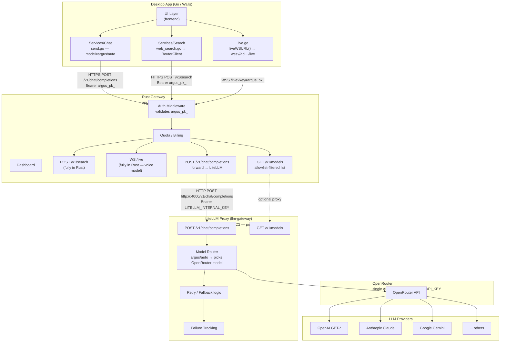
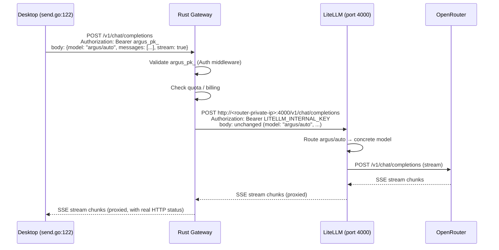
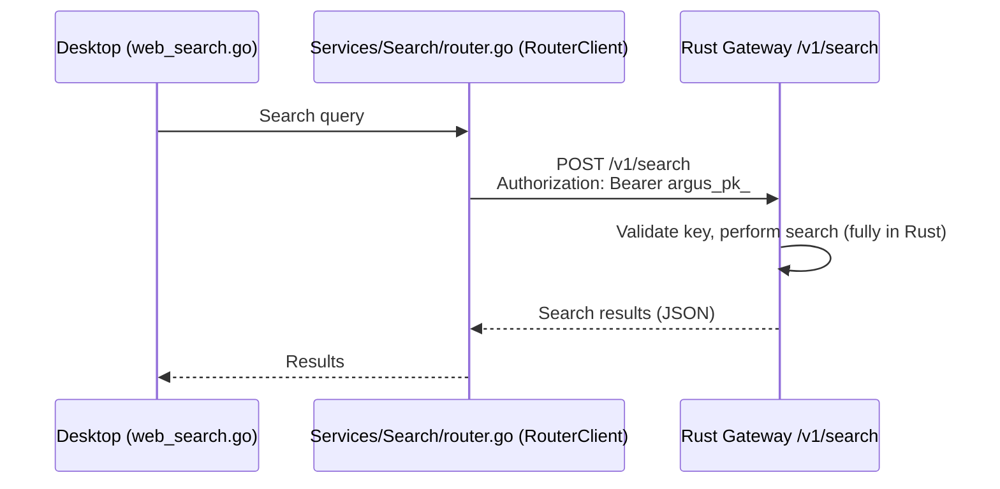
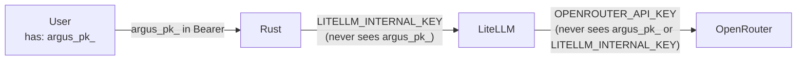

# Argus LLM Gateway — Architecture

> [!IMPORTANT]
> This document is the canonical reference for how the Argus stack is layered. When in doubt about where a responsibility lives, start here.

---

## 1. System Overview

The Argus backend is split into two server-side components that deliberately own different concerns:

| Layer | Language | Host | Public? |
|---|---|---|---|
| Rust Gateway | Rust | EC2 (api.anyscapelabs.com) | ✅ Yes (HTTPS/WSS) |
| LiteLLM Proxy (llm-gateway) | Python | Dedicated EC2 (private VPC IP) | ❌ Internal only (port 4000) |

The Desktop app talks **only** to the Rust gateway. The Rust gateway raw-forwards chat completions to LiteLLM on a separate EC2 instance. Everything else (search, voice/live WebSocket) stays entirely within Rust.

---

## 2. Full System Diagram



---

## 3. What Each Layer Owns

### 3.1 Desktop App (Go / Wails)

| Responsibility | Location |
|---|---|
| Wails app shell & IPC | `main.go`, `app.go` |
| `argus_pk_` key storage | OS keyring (via `Services/Auth`) |
| Chat request construction | `Services/Chat/send.go:122` — sets `modelRef = Shared.RouterAutoModelRef` (`argus/auto`) |
| Agent loop & streaming | `Services/Chat/agent_loop.go` |
| Search routing | `Services/Search/router.go` → `RouterClient` |
| Voice WebSocket | `live.go` → `liveWSURL()` |

**Key invariant:** The desktop always sends `argus/auto` as the model. It never selects a concrete model. Model selection is entirely delegated to LiteLLM.

The desktop constructs **all** request URLs from a single base URL (the Rust gateway public address). It has no knowledge of LiteLLM's existence.

---

### 3.2 Rust Gateway (`api.anyscapelabs.com`)

| Responsibility | Stays in Rust? |
|---|---|
| TLS termination | ✅ |
| `argus_pk_` validation | ✅ Always — user keys NEVER reach LiteLLM |
| Quota / billing / metering | ✅ |
| Dashboard API | ✅ |
| `POST /v1/search` (web search) | ✅ Fully in Rust |
| `WS /live` (voice) | ✅ Fully in Rust |
| `GET /v1/models` | ✅ allowlist-filtered local catalog |
| `POST /v1/chat/completions` | ⏩ **Forwarded to LiteLLM** after auth passes |

When forwarding chat completions, Rust:
1. Strips the user's `argus_pk_` from the request.
2. Rewrites `Authorization: Bearer {LITELLM_INTERNAL_KEY}`.
3. Streams the LiteLLM response back directly to the client.
4. Forwards the **actual** HTTP status code (not always 200).

---

### 3.3 LiteLLM Proxy (llm-gateway)

| Responsibility | Notes |
|---|---|
| `POST /v1/chat/completions` | Main entry point from Rust |
| `GET /v1/models` | Lists available Argus models |
| `argus/auto` routing | Picks the best available OpenRouter model |
| Retry / fallback | Transparent to Rust and Desktop |
| Failure tracking | Avoids routing to degraded models |
| `GET /metrics` | Prometheus-compatible metrics |
| `GET /health` | Health check |

LiteLLM knows **nothing** about users or `argus_pk_` keys. Its only credentials are:
- `LITELLM_INTERNAL_KEY` — authenticates calls from Rust.
- `OPENROUTER_API_KEY` — authenticates calls to OpenRouter.

---

### 3.4 OpenRouter

Single upstream provider. All LLM provider traffic goes through one OpenRouter account using `OPENROUTER_API_KEY`. This simplifies key management (one secret, many providers) and gives unified usage analytics.

---

## 4. Request Flow — Chat Completions



**Step-by-step with code paths:**

1. **`Services/Chat/send.go:122`** — `modelRef = Shared.RouterAutoModelRef` (`"argus/auto"`). Request is assembled and sent to the Rust gateway base URL.
2. **`Router/router.go Run()`** (Desktop) — dispatches the HTTP request; handles streaming SSE.
3. **Rust Auth Middleware** — extracts Bearer token, validates `argus_pk_`, attaches user context.
4. **Rust Quota** — checks usage limits; returns `429` if exceeded.
5. **Rust Chat Forward Handler** — rewrites `Authorization` header, calls `$LLM_GATEWAY_URL/v1/chat/completions`, begins streaming response back.
6. **LiteLLM Router** — sees `model: argus/auto`, applies configured routing rules (see `config/litellm_config.yaml`).
7. **LiteLLM → OpenRouter** — forwards using `OPENROUTER_API_KEY`.
8. **Stream back** — SSE chunks flow from OpenRouter → LiteLLM → Rust → Desktop with minimal buffering.
9. **`Services/Chat/agent_loop.go`** — parses SSE chunks, assembles tool calls or text, drives the agent loop.

---

## 5. Request Flow — Voice / Live WebSocket

```mermaid
sequenceDiagram
    participant D as Desktop (live.go)
    participant R as Rust Gateway /live
    participant V as Voice Model (upstream)

    D->>R: WS Upgrade: wss://api.anyscapelabs.com/live?key=argus_pk_
    R->>R: Validate argus_pk_ BEFORE upgrade (return HTTP 401 if invalid)
    R->>V: Connect to upstream voice model WebSocket
    Note over R,V: If upstream fails → HTTP 400/503 (before upgrade)
    R-->>D: 101 Switching Protocols
    D<-->>R: Bidirectional audio/event frames
    R<-->>V: Bidirectional audio/event frames
    Note over R: On error mid-session:<br/>send WS close frame with reason
```

**Key facts:**
- `live.go` calls `liveWSURL()` which constructs: `wss://api.anyscapelabs.com/v1/live?key={argus_pk_}`
- **This path never touches LiteLLM.** Voice stays entirely in the Rust gateway.
- Rust connects directly to the upstream voice model's WebSocket and proxies frames.
- The desktop expects: proper WebSocket upgrade or a pre-upgrade HTTP error (400/401/503).

---

## 6. Request Flow — Web Search



- Implemented in `Services/Search/router.go` via `RouterClient`.
- Hits `POST /v1/search` on the Rust gateway.
- **Never forwarded to LiteLLM.** Search is a Rust-native feature.

---

## 7. Why the Split?

| Concern | Rust Gateway | LiteLLM |
|---|---|---|
| Auth & key validation | ✅ Rust — single source of truth | ❌ Never |
| Billing / quota | ✅ Rust | ❌ Never |
| Search | ✅ Rust | ❌ Never |
| Voice WebSocket | ✅ Rust | ❌ Never |
| LLM model routing | ❌ Rust has no model routing logic | ✅ LiteLLM — sole owner |
| Fallbacks & retries | ❌ Not Rust's job | ✅ LiteLLM built-in |
| Adding new LLM models | ❌ Would require Rust rebuild | ✅ Edit YAML, restart container |

**The core insight:** LLM routing is dynamic and failure-prone. Models go down, rate limits hit, new models launch. LiteLLM solves this in Python with hot-reloadable config. Rust stays lean and handles everything that requires security guarantees.

---

## 8. Internal Networking on EC2

```
┌───────────────────────────┐         ┌───────────────────────────┐
│  API EC2 (public :443)    │         │  Router EC2 (:4000)       │
│  ┌─────────────────────┐  │  HTTP   │  ┌─────────────────────┐  │
│  │  Rust Gateway       │──┼────────▶│  │  LiteLLM Proxy      │  │
│  └─────────────────────┘  │  VPC    │  └─────────────────────┘  │
└───────────────────────────┘         └───────────────────────────┘
```

- The router Security Group allows TCP 4000 **only** from the API instance's Security Group.
- Port 4000 is **not** exposed to the public internet.
- `LLM_GATEWAY_URL` on the API points at the router's private IP; `LLM_GATEWAY_KEY` must match LiteLLM's `LITELLM_INTERNAL_KEY`.

---

## 9. Security Model



| Secret | Held by | Scope |
|---|---|---|
| `argus_pk_` | User (OS keyring) | User ↔ Rust only |
| `LITELLM_INTERNAL_KEY` | Rust + LiteLLM | Rust ↔ LiteLLM only (service-to-service) |
| `OPENROUTER_API_KEY` | LiteLLM only | LiteLLM ↔ OpenRouter only |

**Guarantees:**
- If LiteLLM is compromised, the attacker gets `OPENROUTER_API_KEY` and `LITELLM_INTERNAL_KEY`, but **not** any user `argus_pk_` keys and **not** user data beyond in-flight requests.
- LiteLLM cannot impersonate users or access the billing/quota system.
- `argus_pk_` keys are stored in the OS keyring on the user's machine, not in any config file.
