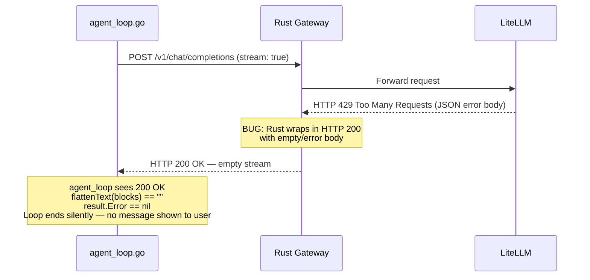
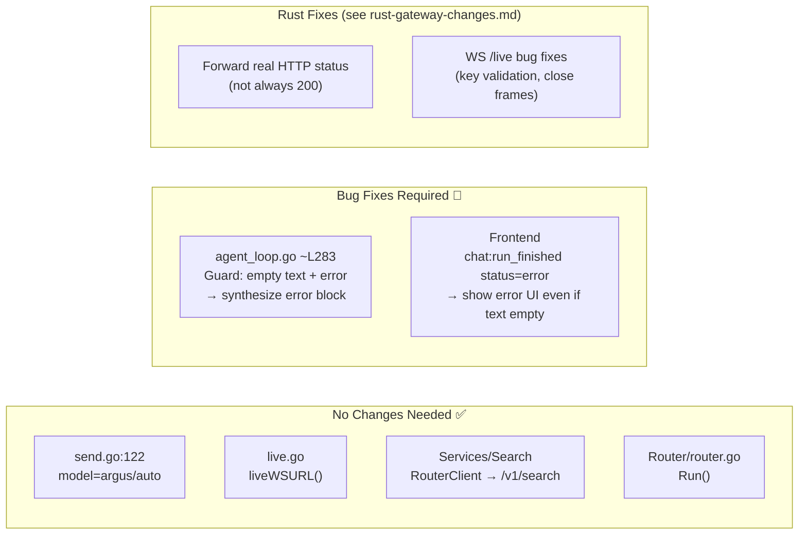

# Argus LLM Gateway — Desktop Changes

> [!NOTE]
> The desktop (`/home/brnx/Desktop/argus`) requires **minimal** changes. The routing architecture (sending `argus/auto`, the Rust gateway base URL) is already correct. Only two bug fixes are needed in the Go code.

---

## 1. What Does NOT Need to Change

### 1.1 Model Routing — Zero Changes Needed

The desktop already does the right thing. In `Services/Chat/send.go` around line 122:

```go
// send.go:122 — already correct
modelRef = Shared.RouterAutoModelRef  // "argus/auto"
```

`argus/auto` is sent to the Rust gateway as-is. The Rust gateway forwards it to LiteLLM. LiteLLM resolves `argus/auto` to a concrete model. **The desktop is not involved in model selection.** No changes needed here.

### 1.2 Voice / Live — Zero Changes Needed

`live.go` correctly constructs the WebSocket URL:

```go
// live.go — already correct
func liveWSURL(baseURL, key string) string {
    // Produces: wss://api.anyscapelabs.com/live?key=argus_pk_xxx
    return fmt.Sprintf("%s/live?key=%s", strings.Replace(baseURL, "https://", "wss://", 1), key)
}
```

**The bugs are on the Rust gateway side** (see `rust-gateway-changes.md`). Once Rust returns proper HTTP errors before the WebSocket upgrade, the Go WebSocket client library will surface them as connection errors with HTTP status codes, which existing error-handling code can use.

**Desktop contract with the `/live` endpoint:**
1. The desktop expects a valid `101 Switching Protocols` response if the session can start.
2. If setup fails, the desktop expects an HTTP error response (401, 503) **before** the upgrade — not a silent close after upgrade.
3. If an error occurs mid-session, the desktop expects a WebSocket close frame with a close code and reason string, not a silent TCP drop.

### 1.3 Search — Zero Changes Needed

`Services/Search/web_search.go` and `Services/Search/router.go` correctly route to `POST /v1/search` on the Rust gateway. No changes needed.

---

## 2. Bug Fix 1 — 502 Silent Failure (`agent_loop.go`)

### 2.1 The Problem



The user sees an empty assistant message bubble. No error, no retry prompt, no explanation. This is the silent 502 failure.

### 2.2 The Fix

> [!IMPORTANT]
> This fix is a defensive guard on the **desktop side**. The primary fix is in the Rust gateway (forward the real HTTP status). This guard handles edge cases where Rust correctly sends a non-200 but the stream body is empty or the error block parsing fails.

In `Services/Chat/agent_loop.go`, around **line 283**, after `text := flattenText(blocks)`:

**Before:**

```go
// agent_loop.go (before fix) — around line 283
text := flattenText(blocks)

// No guard: if text is empty and there's an error, nothing happens.
// The loop exits cleanly as if everything was fine.
```

**After:**

```go
// agent_loop.go (after fix) — around line 283
text := flattenText(blocks)

// Guard: if the stream ended with an error and produced no visible text,
// synthesize a user-facing error block so the UI shows something.
if result.Error != nil && strings.TrimSpace(text) == "" {
    errText := publicModelError  // generic fallback message
    if result.Error.Code == Protocol.CodeRateLimited || Protocol.IsUsageLimit(result.Error.Code) {
        // Show the actual rate limit / usage message — it's user-actionable
        errText = result.Error.Message
    }
    blocks = []Protocol.Block{{Type: Protocol.BlockText, Text: errText}}
    text = errText
}
```

**Explanation of each branch:**

| Condition | `errText` value | Rationale |
|---|---|---|
| Generic model/server error | `publicModelError` (e.g., "Something went wrong. Please try again.") | Don't expose internal errors |
| `CodeRateLimited` | `result.Error.Message` | User needs to know they're rate limited |
| `IsUsageLimit(code)` | `result.Error.Message` | User needs to know their quota is exhausted |

**Required imports** (if not already present):

```go
import (
    "strings"
    // ... existing imports ...
    Protocol "github.com/anyscapelabs/argus/Services/Protocol"
)
```

**Where `publicModelError` is defined:** this should already be a package-level constant in `agent_loop.go` or `Services/Chat/constants.go`. If not, add:

```go
const publicModelError = "Something went wrong. Please try again."
```

---

## 3. Bug Fix 2 — Frontend Error State

### 3.1 The Problem

Even after Bug Fix 1 above, there is a second layer: the frontend (Wails/JS side). When the Go backend fires the `chat:run_finished` event with `status=error`, the frontend may not show any error UI if the message row's text content is empty or was never populated.

### 3.2 The Event

The event is defined in `Services/Shared/events.go`:

```go
// Services/Shared/events.go
const EventChatRunFinished = "chat:run_finished"
```

The event payload typically includes:
- `status`: `"success"` | `"error"`
- `message_id`: the ID of the assistant message row
- `error_code`: (optional) machine-readable error code

### 3.3 The Fix — Frontend

When `chat:run_finished` fires with `status=error`, the frontend **must** show visible feedback to the user even if the message row's text content is empty:

```typescript
// In your Wails frontend event handler (pseudo-code / React example)
runtime.EventsOn("chat:run_finished", (payload) => {
  if (payload.status === "error") {
    const messageRow = getMessageById(payload.message_id);

    if (!messageRow || messageRow.text.trim() === "") {
      // The message row is empty — the backend error guard may not have fired yet,
      // or the error happened before any text was written.
      // Show a fallback error state directly in the message bubble.
      setMessageError(payload.message_id, {
        text: payload.error_message ?? "Something went wrong. Please try again.",
        isError: true,
      });
    }
    // If message row has text (populated by Bug Fix 1), it's already visible.
  }
});
```

**Key rule:** A message row with `status=error` should **never** be rendered as visually empty. Options:
- Replace empty text with a styled error message in the bubble.
- Show an error banner below the message bubble.
- Both.

> [!TIP]
> The cleanest approach is to always set `isError=true` on the message row when `chat:run_finished` fires with `status=error`, and have the message bubble component render an error style (red border, error icon) regardless of whether the text content is empty. The text from Bug Fix 1 fills in the bubble content; the styling handles the case where it's still empty.

---

## 4. Summary



| File | Change Type | Priority |
|---|---|---|
| `Services/Chat/agent_loop.go` (~L283) | Bug fix — empty text guard | 🔴 Blocker |
| Frontend `chat:run_finished` handler | Bug fix — error state rendering | 🔴 Blocker |
| `Services/Chat/send.go:122` | No change needed | — |
| `live.go` | No change needed | — |
| `Services/Search/web_search.go` | No change needed | — |
| `Router/router.go` | No change needed | — |
