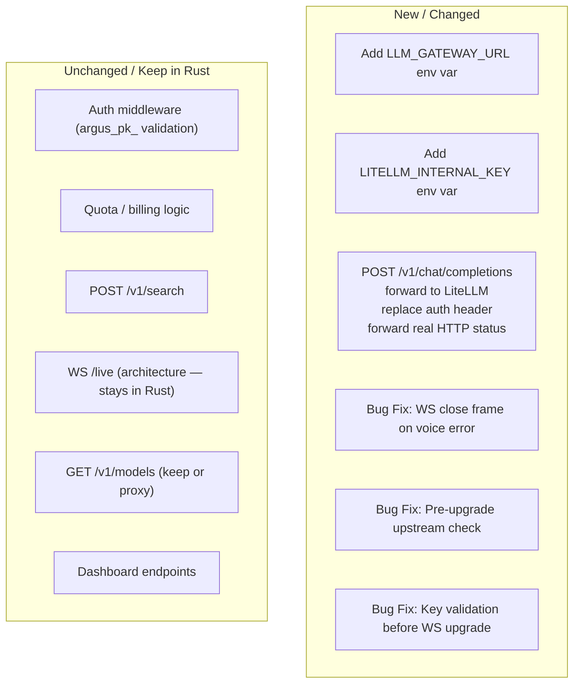

# Argus LLM Gateway — Rust Gateway Changes

> [!IMPORTANT]
> This document is the implementation specification for changes needed in the Rust gateway (`api.anyscapelabs.com`) to integrate with the LiteLLM proxy. Read this before touching any Rust code.

---

## 1. New Environment Variables

Add these to the Rust gateway's environment (systemd unit, `.env`, or EC2 parameter store):

```bash
# Base URL of the LiteLLM proxy (internal — not public internet)
# Same instance:
LLM_GATEWAY_URL=http://localhost:4000
# Docker Compose internal network:
LLM_GATEWAY_URL=http://llm-gateway:4000
# Separate VPC instance (use private IP):
LLM_GATEWAY_URL=http://10.0.1.42:4000

# Service-to-service auth key for LiteLLM.
# Must match LITELLM_INTERNAL_KEY in the llm-gateway .env.
# Generate: openssl rand -hex 32
LITELLM_INTERNAL_KEY=sk-internal-xxxxxxxxxxxxxxxxxxxxxxxxxxxxxxxx
```

Load these in the Rust config/settings struct wherever other env vars are read (e.g., `Config::from_env()`):

```rust
pub struct Config {
    // ... existing fields ...

    /// Base URL of the internal LiteLLM proxy
    #[serde(default = "default_llm_gateway_url")]
    pub llm_gateway_url: String,

    /// Service-to-service key for authenticating with LiteLLM
    pub litellm_internal_key: String,
}

fn default_llm_gateway_url() -> String {
    "http://localhost:4000".to_string()
}
```

---

## 2. Chat Completions Forwarding

### 2.1 Endpoint: `POST /v1/chat/completions`

After the auth middleware validates `argus_pk_` and quota is confirmed, forward the full request body to LiteLLM. **Do not modify the request body** — pass `model: "argus/auto"` through as-is; LiteLLM handles routing.

### 2.2 Implementation Pattern

```rust
async fn handle_chat_completions(
    State(config): State<Arc<Config>>,
    Extension(user): Extension<AuthenticatedUser>,
    headers: HeaderMap,
    body: Bytes,
) -> impl IntoResponse {
    let upstream_url = format!("{}/v1/chat/completions", config.llm_gateway_url);

    let client = reqwest::Client::new();

    let mut req_builder = client
        .post(&upstream_url)
        // Replace user's argus_pk_ with internal service key
        .header(
            "Authorization",
            format!("Bearer {}", config.litellm_internal_key),
        )
        .header("Content-Type", "application/json")
        // Observability headers
        .header("X-Request-ID", generate_request_id())
        .header("X-Forwarded-For", user.ip_address.as_deref().unwrap_or("unknown"))
        .body(body);

    let upstream_response = match req_builder.send().await {
        Ok(r) => r,
        Err(e) => {
            tracing::error!("Failed to reach LiteLLM: {e}");
            return (
                StatusCode::BAD_GATEWAY,
                Json(json!({"error": "LLM service unavailable"})),
            )
                .into_response();
        }
    };

    // ─────────────────────────────────────────────────────────────────────
    // CRITICAL FIX: Forward the ACTUAL HTTP status code from LiteLLM.
    // Do NOT swallow non-200 responses into a 200 OK wrapper.
    // The desktop's agent loop relies on HTTP status to detect errors.
    // ─────────────────────────────────────────────────────────────────────
    let status = upstream_response.status();
    let upstream_headers = upstream_response.headers().clone();

    // Propagate content-type (application/json OR text/event-stream for streaming)
    let mut response_builder = Response::builder().status(status);

    if let Some(ct) = upstream_headers.get("content-type") {
        response_builder = response_builder.header("content-type", ct);
    }

    // Stream the body back byte-for-byte
    let body_stream = upstream_response.bytes_stream();
    response_builder
        .body(Body::from_stream(body_stream))
        .unwrap_or_else(|_| {
            Response::builder()
                .status(StatusCode::INTERNAL_SERVER_ERROR)
                .body(Body::empty())
                .unwrap()
        })
}
```

### 2.3 Headers to Forward

| Header | Direction | Purpose |
|---|---|---|
| `Authorization: Bearer {LITELLM_INTERNAL_KEY}` | Rust → LiteLLM | Service-to-service auth |
| `Content-Type: application/json` | Rust → LiteLLM | Request body type |
| `X-Request-ID: {uuid}` | Rust → LiteLLM | End-to-end tracing |
| `X-Forwarded-For: {user IP}` | Rust → LiteLLM | Audit trail |
| `Content-Type` (from LiteLLM response) | LiteLLM → Client | SSE or JSON |

**Do NOT forward** the user's `Authorization` header to LiteLLM. Strip it and replace with `LITELLM_INTERNAL_KEY`.

---

## 3. The Critical Bug Fix — HTTP Status Code Forwarding

> [!CAUTION]
> **502 Silent Failure Bug**: If LiteLLM returns HTTP 429, 503, or 400, the current Rust code may wrap this in a `200 OK` response with an empty or error body. The desktop's `agent_loop.go` sees `200 OK`, gets no text chunks, and silently finishes with an empty message. The user sees nothing.

**The fix:**

```rust
// ❌ WRONG — do not do this:
let status = StatusCode::OK; // Always 200

// ✅ CORRECT — use the actual upstream status:
let status = upstream_response.status(); // Could be 429, 503, 400, etc.
```

When the desktop receives a non-200 status on a streaming request, it can:
1. Read the error body (JSON from LiteLLM).
2. Surface a human-readable error to the user.
3. Trigger the guard in `agent_loop.go` (see `desktop-changes.md`).

---

## 4. What Stays in Rust — Do NOT Forward

The following endpoints must **not** be forwarded to LiteLLM:

### 4.1 `GET /v1/models`

Either:
- Keep a static list of supported Argus models in Rust, **or**
- Proxy to `http://localhost:4000/v1/models` with `LITELLM_INTERNAL_KEY` and return the response.

If proxying, strip LiteLLM's internal model names before returning to the client if they differ from the Argus-facing names.

### 4.2 `POST /v1/search`

Fully implemented in Rust. No changes needed. Never forward to LiteLLM.

### 4.3 `WS /live` (Voice WebSocket)

Fully implemented in Rust. Never forward to LiteLLM. See Section 5 for required bug fixes.

### 4.4 All Auth / Key Validation

The `argus_pk_` validation middleware runs on **every** request before any handler. This is a Rust responsibility and must stay that way.

### 4.5 All Billing / Quota Logic

Quota checking happens in Rust after auth and before forwarding. LiteLLM has no billing awareness.

---

## 5. Voice / Live WebSocket Bug Fixes

> [!NOTE]
> The `/live` endpoint stays entirely in Rust. These are standalone fixes unrelated to LiteLLM integration. The desktop's `live.go` is correct — the bugs are in the Rust handler.

```mermaid
sequenceDiagram
    participant D as Desktop (live.go)
    participant R as Rust /live handler
    participant V as Voice Model (upstream WS)

    D->>R: WS Upgrade: wss://api.anyscapelabs.com/live?key=argus_pk_
    Note over R: BUG 3 FIX: Validate key HERE,<br/>before upgrade attempt
    alt Invalid key
        R-->>D: HTTP 401 Unauthorized (plain HTTP, no upgrade)
    else Valid key
        R->>V: Connect to upstream voice WebSocket
        alt Upstream connection fails
            Note over R: BUG 2 FIX: Return HTTP 400/503<br/>before upgrade
            R-->>D: HTTP 503 Service Unavailable
        else Upstream connected
            R-->>D: 101 Switching Protocols
            D<-->>R: Audio/event frames
            R<-->>V: Audio/event frames
            alt Error mid-session
                Note over R: BUG 1 FIX: Send WS close frame
                V-->>R: Error frame / disconnect
                R-->>D: WS Close frame (code 1011, reason: error message)
            end
        end
    end
```

### Bug 1 — Upstream Error Mid-Session: Silent Connection Drop

**Problem:** When the upstream voice model returns an error or disconnects mid-session, the Rust handler closes the client-facing WebSocket without sending a proper close frame. The desktop interprets this as a network drop, not an application error. `LiveConfig()` on the desktop has no way to show the user what went wrong.

**Fix:** When the upstream voice WebSocket closes or errors, send a WebSocket close frame to the desktop client before dropping the connection:

```rust
// In the WebSocket proxy loop, when upstream closes:
match upstream_msg {
    Err(e) => {
        tracing::error!("Upstream voice WS error: {e}");
        // Send a proper close frame with an application error code
        let close_frame = CloseFrame {
            code: CloseCode::Error,  // 1011 — Internal Error
            reason: Cow::from(format!("Voice session error: {e}")),
        };
        let _ = client_ws.send(Message::Close(Some(close_frame))).await;
        break;
    }
    Ok(Message::Close(frame)) => {
        // Forward the upstream close frame to the client
        let _ = client_ws.send(Message::Close(frame)).await;
        break;
    }
    // ... handle other message types ...
}
```

---

### Bug 2 — Upstream Connection Failure Before Upgrade: Timeout Instead of Error

**Problem:** If the upstream voice model is unavailable and the Rust handler has already performed the WebSocket upgrade with the desktop client, the desktop enters the WebSocket state but never receives a valid session. It eventually times out. `LiveConfig()` receives a timeout error, not a meaningful error code.

**Fix:** Attempt the upstream voice model connection **before** sending `101 Switching Protocols` to the client. If it fails, respond with an appropriate HTTP error:

```rust
async fn live_handler(
    ws: WebSocketUpgrade,
    Query(params): Query<LiveParams>,
    State(config): State<Arc<Config>>,
) -> impl IntoResponse {
    // BUG 3 FIX: validate key before anything else (see Bug 3 below)
    if !validate_key(&params.key, &config).await {
        return (StatusCode::UNAUTHORIZED, "Invalid API key").into_response();
    }

    // BUG 2 FIX: attempt upstream connection before upgrading
    let upstream_ws = match connect_to_voice_model(&config).await {
        Ok(ws) => ws,
        Err(e) => {
            tracing::error!("Voice model unavailable: {e}");
            return (
                StatusCode::SERVICE_UNAVAILABLE,
                "Voice service temporarily unavailable",
            )
                .into_response();
        }
    };

    // Only NOW perform the WebSocket upgrade — we know upstream is ready
    ws.on_upgrade(move |client_ws| handle_live_session(client_ws, upstream_ws))
}
```

---

### Bug 3 — Key Validation After WebSocket Upgrade: Silent 401

**Problem:** The `argus_pk_` key validation currently may happen after the WebSocket upgrade handshake is accepted (HTTP 101). An invalid key results in the connection being closed from the server side, but the desktop has already committed to the WebSocket state. The desktop's `LiveConfig()` sees a connection that immediately closes, not an HTTP 401, and cannot distinguish "bad key" from "network error."

**Fix:** Validate the key extracted from the query parameter (`?key=argus_pk_`) as the **first step** of the handler, before calling `ws.on_upgrade()`. Return `HTTP 401` for invalid keys. This is a plain HTTP response (not a WebSocket close), which the desktop can inspect before attempting to use the WebSocket.

```rust
// The key comes from query param: wss://.../live?key=argus_pk_xxx
let raw_key = &params.key;

if !config.key_store.validate(raw_key).await {
    return (
        StatusCode::UNAUTHORIZED,
        Json(json!({"error": "Invalid API key", "code": "auth/invalid-key"})),
    )
        .into_response();
}

// Proceed with WebSocket upgrade only after validation passes
```

**Desktop contract:** `live.go` constructs the URL and initiates the WebSocket connection. If Rust returns HTTP 401 or 503 before the upgrade, the Go WebSocket library surfaces this as a connection error with the HTTP status code, which `LiveConfig()` can read and display to the user.

---

## 6. Summary of Changes



| Change | File / Module | Priority |
|---|---|---|
| `LLM_GATEWAY_URL` env var | `config.rs` or `settings.rs` | 🔴 Blocker |
| `LITELLM_INTERNAL_KEY` env var | `config.rs` or `settings.rs` | 🔴 Blocker |
| Forward `POST /v1/chat/completions` to LiteLLM | `handlers/chat.rs` or equivalent | 🔴 Blocker |
| Forward actual HTTP status code (not always 200) | `handlers/chat.rs` | 🔴 Blocker — fixes silent failure |
| Add `X-Request-ID` and `X-Forwarded-For` headers | `handlers/chat.rs` | 🟡 Important |
| Bug 3: Key validation before WS upgrade | `handlers/live.rs` | 🔴 Blocker |
| Bug 2: Pre-upgrade upstream connection check | `handlers/live.rs` | 🔴 Blocker |
| Bug 1: WS close frame on upstream error | `handlers/live.rs` | 🟡 Important |
